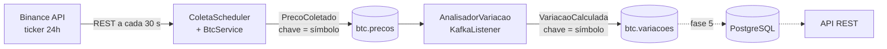

<p align="center">
  
</p>

<h1 align="center">btc-monitor</h1>

<p align="center">
  Monitor de preço do Bitcoin orientado a eventos, com <b>Apache Kafka</b> e <b>Spring Boot</b>.
</p>

<p align="center">
  <a href="https://github.com/cauacouto/btc-monitor/actions/workflows/ci.yml"></a>
  
  
</p>

<p align="center">
  
  
  
  
  
  
  
  
</p>

---

A cada 30 segundos a aplicação consulta o preço do BTC na Binance e publica a leitura num tópico do Kafka. Um consumidor compara cada preço com o anterior, classifica o movimento como **SUBIU** 📈, **CAIU** 📉 ou **ESTAVEL** ➖ e publica o resultado em outro tópico.

> Projeto de estudo e portfólio. Não é recomendação de investimento.

## Arquitetura



1. **Coleta**: um `@Scheduled` com `fixedDelay` chama o `BtcService`, que busca o ticker na Binance pelo `BinanceClient` (`RestClient` com timeouts), converte para `PrecoColetado` e publica em `btc.precos`.
2. **Análise**: o `AnalisadorVariacao` consome `btc.precos`, guarda o último preço de cada símbolo, calcula a variação percentual entre leituras e classifica o movimento.
3. **Resultado**: a `VariacaoCalculada` é publicada em `btc.variacoes`, pronta para ser gravada no banco e exposta por API.

## Stack

| Camada | Tecnologia |
|---|---|
| Linguagem | Java 21 |
| Framework | Spring Boot 4.1 (Spring Web, Spring for Apache Kafka, Spring Data JPA) |
| Mensageria | Apache Kafka em modo KRaft (sem Zookeeper), um nó via Docker Compose |
| Observação dos tópicos | Kafka UI (kafbat) |
| Fonte de dados | Binance REST pública (`/api/v3/ticker/24hr`) |
| Cliente HTTP | `RestClient` com `SimpleClientHttpRequestFactory` |
| Serialização | JSON com `JacksonJsonSerializer` / `JacksonJsonDeserializer` |
| Banco | PostgreSQL (persistência na fase 5) |
| Build | Maven (wrapper incluso) |
| Qualidade | GitHub Actions + Checkstyle |

## Tópicos e eventos

| Tópico | Partições | Chave | Valor |
|---|---|---|---|
| `btc.precos` | 3 | símbolo (`BTCUSDT`) | `PrecoColetado` |
| `btc.variacoes` | 3 | símbolo (`BTCUSDT`) | `VariacaoCalculada` |

Os tópicos são criados pelo próprio código (`@Bean NewTopic`), então nascem iguais em qualquer máquina.

**`btc.precos`**
```json
{
  "simbolo": "BTCUSDT",
  "preco": 64366.66000000,
  "variacao24h": -0.303,
  "coletadoEm": "2026-11-18T02:40:58.026269652Z"
}
```

**`btc.variacoes`**
```json
{
  "simbolo": "BTCUSDT",
  "precoAnterior": 64377.26000000,
  "precoAtual": 64366.66000000,
  "variacaoPercentual": -0.0165,
  "movimento": "CAIU",
  "calculadoEm": "2026-11-18T02:40:58.026269652Z"
}
```

### Regra de classificação

```
variação % = (atual − anterior) × 100 ÷ anterior      (4 casas, HALF_UP)

|variação| <  limiar  →  ESTAVEL
 variação >= limiar   →  SUBIU
 variação <= −limiar  →  CAIU
```

O limiar padrão é **0,01%** (`btc.analise.limiar-estavel`). Ele evita que oscilações de centavos sejam classificadas como movimento.

## Decisões técnicas

| Decisão | Motivo |
|---|---|
| Chave da mensagem = símbolo | mesma chave, mesma partição: as leituras de cada moeda chegam **em ordem** ao consumidor, o que permite comparar com a anterior |
| `fixedDelay` em vez de `fixedRate` | a próxima coleta só começa depois que a anterior termina; chamadas lentas à Binance não se acumulam |
| `BigDecimal` para preços e percentuais | `double` arredonda (0,1 vira 0,1000000000000000055…); dinheiro parte sempre do texto da API |
| Eventos como `record` | um evento é um fato passado: imutável, sem setters |
| Fato bruto × derivado em tópicos separados | se a regra de análise mudar, basta reprocessar `btc.precos` |
| `calculadoEm` = horário da coleta | reprocessar o tópico gera exatamente as mesmas variações |
| `Clock` injetado | o horário fica controlável nos testes |
| Um `KafkaTemplate` tipado por evento | o compilador impede publicar o objeto errado no tópico errado |
| Falha na Binance gera `warn`, não derruba a aplicação | rede fora é passageira; a próxima coleta tenta de novo |
| Preço zero ou resposta vazia nunca é publicado | quem consome o tópico pode confiar nos dados sem repetir a validação |

## Como rodar

### Pré-requisitos
- JDK 21
- Docker com Docker Compose
- PostgreSQL rodando localmente

### 1. Subir Kafka e Kafka UI
```bash
docker compose up -d
```
- Kafka: `localhost:9092`
- Kafka UI: http://localhost:8081

### 2. Variáveis de ambiente
| Variável | Exemplo |
|---|---|
| `KAFKA_HOST` | `localhost:9092` |
| `DB_URL` | `jdbc:postgresql://localhost:5432/btc_monitor` |
| `DB_USER` | `postgres` |
| `DB_PASSWORD` | `sua-senha` |

### 3. Executar
```bash
./mvnw spring-boot:run
```

No log aparece, a cada coleta:
```
preço coletado: PrecoColetado[simbolo=BTCUSDT, preco=64366.66000000, ...]
publicado BTCUSDT na partição 2 offset 29
variação BTCUSDT CAIU publicada na partição 2 offset 1
```

### Configuração

| Propriedade | Padrão | Descrição |
|---|---|---|
| `btc.coleta.simbolo` | `BTCUSDT` | par consultado na Binance |
| `btc.coleta.intervalo` | `30000` | intervalo entre coletas, em ms |
| `btc.analise.limiar-estavel` | `0.01` | variação mínima, em %, para não ser `ESTAVEL` |
| `btc.topicos.precos` | `btc.precos` | tópico das leituras |
| `btc.topicos.variacoes` | `btc.variacoes` | tópico das variações |
| `binance.base-url` | `https://api.binance.com` | URL base da API |

## Qualidade

A pipeline de CI (GitHub Actions) roda a cada push na `main` e em todo pull request:

| Job | O que verifica |
|---|---|
| **Lint (Checkstyle)** | nomes fora do padrão Java, imports não usados, `catch` vazio, `if` sem chaves, tabs. Regras de espaçamento aparecem como aviso e serão promovidas a erro aos poucos |
| **Build** | compila e empacota o projeto |

Para rodar o lint localmente (o mesmo da pipeline):
```bash
./mvnw checkstyle:check
```

## Estrutura

```
src/main/java/com/example/bc_monitor
├── client      BinanceClient (RestClient + timeouts)
├── config      Kafka (producer, consumer, tópicos) e Clock
├── consumer    AnalisadorVariacao (@KafkaListener)
├── dto         PrecoColetado, VariacaoCalculada, BinanceTicker24h
├── enums       Movimento
├── producer    PrecoProducer, VariacaoProducer
├── scheduler   coleta agendada
└── service     BtcService
```

## Roadmap

- [x] **Fase 1** — Infraestrutura: projeto, Docker Compose (Kafka KRaft + Kafka UI), tópicos como código
- [x] **Fase 2** — Coleta: client da Binance, service, scheduler e tratamento de falhas
- [x] **Fase 3** — Produção: publicação em `btc.precos`
- [x] **Fase 4** — Análise: consumidor, cálculo e classificação, publicação em `btc.variacoes`
- [ ] **Fase 5** — Persistência e API: PostgreSQL com JPA e Flyway, `GET /precos/ultimo` e `GET /variacoes`
- [ ] **Fase 6** — Testes: unitários da classificação e integração com Kafka real (Testcontainers)

Depois da v1: WebSocket da Binance no lugar do polling, outros pares de moedas, observabilidade (OpenTelemetry + Grafana) e alertas.
